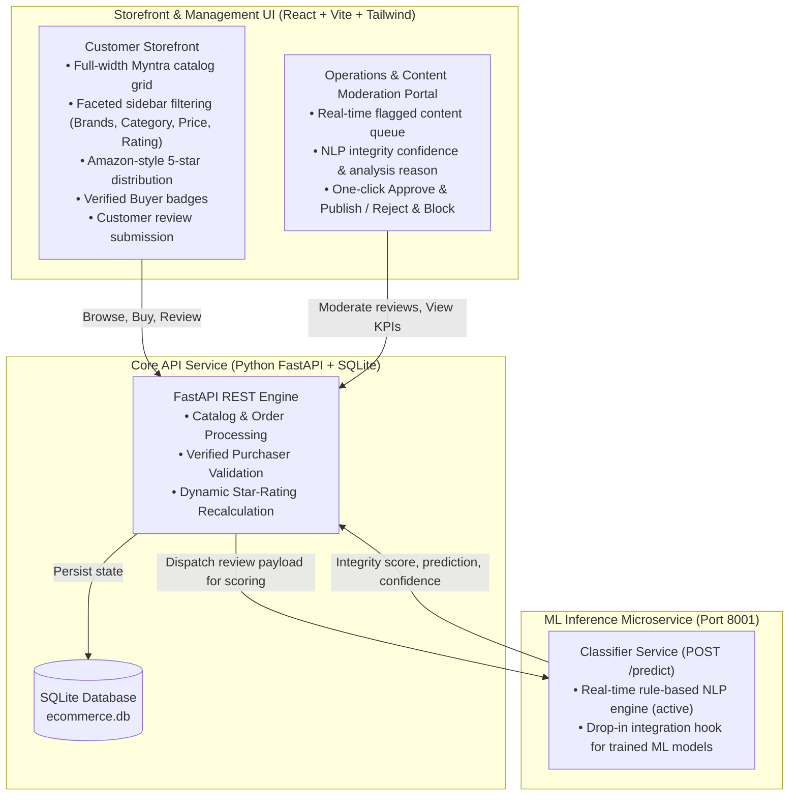

# VERISTORE — Enterprise E-Commerce Platform with Real-Time Review Moderation

A high-performance e-commerce web platform engineered with an authentic **Myntra-grade shopping experience**, **Amazon-standard verified review architecture**, and an **automated content integrity & moderation pipeline**.

---

## 🏗️ Architecture Overview

The system is architected as an asynchronous, decoupled multi-service platform:



---

## ⚡ Key Platform Capabilities

### 1. Customer Storefront (Myntra Design Standard)
- **Full-Width Layout**: Elimination of artificial margins for an expansive, desktop-optimized shopping canvas.
- **Faceted Filter Sidebar**: Real-time multi-attribute filtering by Category, Brand (Sony, Nike, boAt, Noise, Roadster, Levi's), Price Range, and Minimum Customer Rating.
- **Dynamic Sorting**: Instant sorting by *Recommended*, *Customer Rating (High to Low)*, *Price (Low to High)*, and *Price (High to Low)*.
- **Amazon-Grade Rating Distribution**: Dynamic computation of 5-star percentage breakdown bars computed exclusively from verified, approved customer feedback.
- **Verified Buyer Status**: Customers who complete simulated orders automatically receive the verified purchaser credential on subsequent reviews.

### 2. Operations & Content Moderation Portal
- **Automatic Interception**: Reviews containing conversational chatter (e.g. social queries, group chats, phone numbers) or promotional spam are automatically withheld from the public storefront.
- **Legitimate Negative Feedback Preserved**: Genuine negative product criticism (e.g. *"Earcups get uncomfortably warm"*) is recognized as authentic product feedback and approved automatically.
- **Operator Override**: Store managers can review the flagged queue with system confidence scores and execute instant **Approve to Store** or **Reject & Block** actions.

### 3. ML Inference Microservice Contract
The FastAPI backend interfaces with the classifier microservice through a standard REST contract:

- **Endpoint**: `POST http://localhost:8001/predict`
- **Request Format**:
  ```json
  {
    "review_text": "Hey guys does anyone have a used DSLR for sale in Bangalore? Ping me on WhatsApp @tech_guy",
    "headline": "Camera query",
    "rating": 5,
    "product_title": "Sony WH-1000XM5",
    "product_category": "Electronics"
  }
  ```
- **Response Format**:
  ```json
  {
    "is_flagged": true,
    "prediction_type": "OFF_TOPIC_CHAT",
    "confidence": 0.95,
    "flag_reason": "Conversational social chatter detected. Content does not evaluate product features or specifications."
  }
  ```

---

## 🚀 Deployment & Local Execution

### One-Click Launch (Windows)
Double click `start_demo.bat` (or run `.\start_demo.ps1` in PowerShell).
The launcher initializes the ML service, backend API, and frontend server, automatically opening your default web browser to:
👉 **`http://localhost:5173`**

### Manual Service Startup:
1. **ML Microservice (Port 8001)**:
   ```bash
   cd ml_service
   python app.py
   ```
2. **FastAPI Backend (Port 8000)**:
   ```bash
   cd backend
   python run.py
   ```
3. **React Storefront (Port 5173)**:
   ```bash
   cd frontend
   npm run dev
   ```

- **Storefront Application**: `http://localhost:5173`
- **Operations Console**: Accessible via the user profile menu or directly at `http://localhost:5173` (switch to Operations Console).
- **Backend Swagger API**: `http://localhost:8000/docs`
- **ML Microservice Swagger**: `http://localhost:8001/docs`
